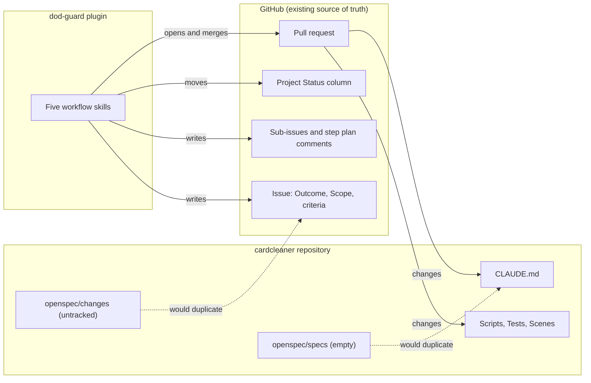
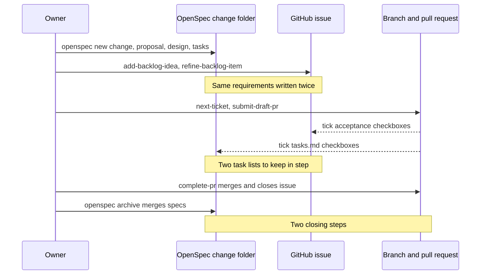
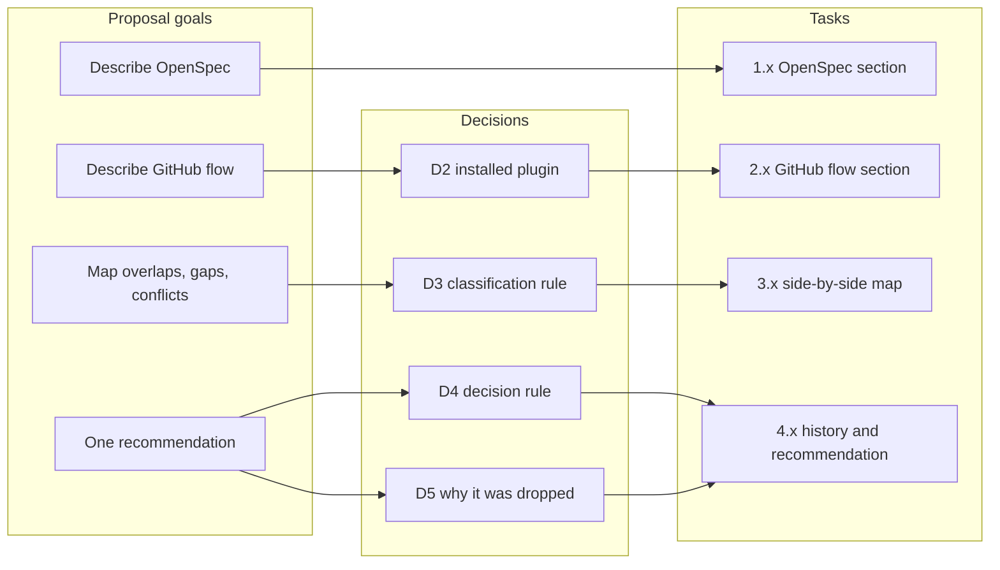

## Context

See `proposal.md` (Why) for the motivation. This section covers only what shapes how the evaluation is done.

- **OpenSpec as set up here.** `openspec init --tools none` created `openspec/config.yaml` (schema `spec-driven`, no project context or rules) and nothing else. No AI-tool files were installed. `openspec list --specs` reports no specs. The only change is this one. A change is a folder under `openspec/changes/<name>/` holding `proposal.md`, `design.md`, `specs/**/spec.md`, `tasks.md` and `.openspec.yaml`. `openspec archive` moves the folder to `changes/archive/` and merges its spec deltas into `openspec/specs/`.
- **The GitHub flow.** cardcleaner's `CLAUDE.md` (section "Canonical dod-guard Workflow") names five skills: `add-backlog-idea`, `refine-backlog-item`, `next-ticket`, `submit-draft-pr` and `complete-pr`. Their rules live in the dod-guard plugin. The plugin's source repo is `~/mcp-servers/dod-guard`. The copy that sessions run is under `~/.claude/plugins/`, which is read only.
- **The earlier decision.** dod-guard's `plugins/dod-guard/standards/project-workflow.md` (lines 12-24) makes the GitHub issue the source of truth for "the outcome, requirements, decisions, plan, tasks, acceptance criteria, and verification" and calls OpenSpec "historical reference only". `plugins/dod-guard/skills/next-ticket/SKILL.md` (line 21) says "Never create a tracked planning file." The switch happened in commit `51037e82` on 2026-09-03. Its old OpenSpec records sit in `docs/archive/openspec-history/`.
- **Constraint.** The investigation changes nothing it evaluates: no game code, tests, CI, `CLAUDE.md`, plugin files or GitHub issues.

## Goals / Non-Goals

**Goals:**
- Every claim in the report can be checked: each one cites a file and line, a command and its output, or a commit.
- The side-by-side map covers every stage of both systems, so no overlap, gap or conflict goes unlisted.
- The recommendation follows from a decision rule written down before the map is filled in.

**Non-Goals:**
- Acting on the recommendation. Removing `openspec/`, installing OpenSpec tool files, editing dod-guard skills or changing `CLAUDE.md` belong to a later change if the recommendation calls for them.
- Judging OpenSpec in general. The report judges its fit with this repository and this workflow only.
- Measuring cost in tokens or time for either system.

## Decisions

**D1. The report lives in this change folder as `evaluation.md`.**
The change's own folder is the planning home the user chose, it is untracked, and no source file changes.
Alternatives considered: `docs/` in cardcleaner would add a tracked file to the repository being evaluated. `C:\Development\Projects\dependency-map2`, where analysis output normally goes, is outside the edit root that the OpenSpec CLI allows for this change (`allowedEditRoots` is the cardcleaner folder). If the recommendation is not to adopt, the user can copy the report there before the folder is removed.

**D2. Read the installed dod-guard plugin, and compare it with the source repository.**
cardcleaner sessions run the installed copy, so its skills are what the GitHub flow does today. The source repository's HEAD shows where it is heading. The report names the installed version and lists any rule that differs between the two.
Alternative considered: reading only the source repository. That could describe rules no session runs yet.

**D3. Classify each pair of stages with one rule.**
For every stage of either system, the report records which file or GitHub record holds its output and which skill or command writes it.
- *Overlap*: both systems hold the same content, but in different places.
- *Conflict*: both systems would write or move the same record, or one system's rule forbids what the other does. One example is "never create a tracked planning file" against OpenSpec's tracked change folder.
- *Gap*: only one system holds that content.
Alternative considered: a free-form comparison. That makes it easy to leave out a stage.

**D4. Decide with a rule written before the map.**
- Adopt as a supplement only when OpenSpec fills a gap, and when every overlap and conflict can be switched off without patching either system.
- Adopt with adjustments when the gap is real but some conflicts need a written rule, such as a rule for who updates `openspec/specs/` after a merge. The report lists each adjustment.
- Otherwise, do not adopt.
The exploration found one gap: OpenSpec's `openspec/specs/` keeps a lasting record of behavior. It also found four conflicts (tasks, status, where the plan lives, closing). So the expected verdict is "do not adopt", or at most "adopt with adjustments" for the spec record alone. The report must confirm or overturn that with evidence.

**D5. Find out why OpenSpec was dropped before judging it again.**
The commit message of `51037e82` gives no reason. The report reads that commit's diff of `AGENTS.md`, `docs/archive/openspec-history/README.md` and the dod-guard history before and after it, and states the reason found. If no written reason exists, the report says so.

## Architecture

*Caption: the dod-guard skills write every planning record to GitHub, while OpenSpec's two folders would hold copies of the issue and of CLAUDE.md in the repository. Supports D3 and D4.*

## Sequence

*Caption: running both systems on one piece of work writes the plan twice, ticks two task lists and needs two closing steps. Supports the conflicts in D3.*

## Detailed Code Change Inventory

| File Path | Change Type | Change Description | Affected Module |
|-----------|-------------|-------------------|-----------------|
| `openspec/changes/evaluate-proposal-system-fit-with-git-project-workflow/evaluation.md` | Added | Sections: how OpenSpec works, how the GitHub flow works, the side-by-side map, why OpenSpec was dropped, the decision rule and the recommendation | This change only |
| Every other file in cardcleaner | Unchanged | Read only | None |
| `~/mcp-servers/dod-guard` and `~/.claude/plugins/` | Unchanged | Read only, as evidence | None |

## Traceability

*Caption: every proposal goal reaches a task, and every decision is applied by at least one task. Supports the task breakdown.*

## Risks / Trade-offs

- [The installed plugin and its source differ, so the report describes a flow that is about to change] -> D2: name the installed version and list each rule that differs.
- [The map is written to confirm the expected verdict] -> D4 writes the decision rule first, and the report must list any evidence that points the other way.
- [The earlier reason for dropping OpenSpec is not written down anywhere] -> D5: say so plainly, and judge on the current evidence alone.
- [The report is lost if `openspec/` is removed after a no-adopt verdict] -> The report's last section names the folder to copy it to before removal.

## Migration Plan

None. Nothing is deployed. To roll back, delete `evaluation.md`.

## Open Questions

- Did the owner miss OpenSpec's living spec record after September, or does `CLAUDE.md` cover it well enough? The answer picks between "do not adopt" and "adopt with adjustments" for the spec record. It changes the report's last section, but not the tasks or the method. The report asks it, and defaults to "do not adopt" if it stays unanswered.
