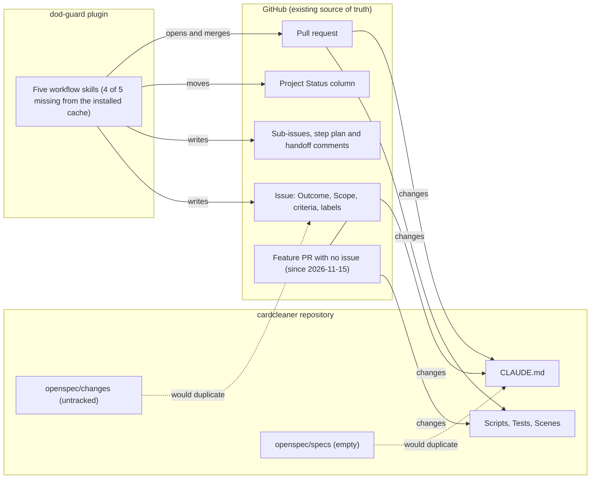
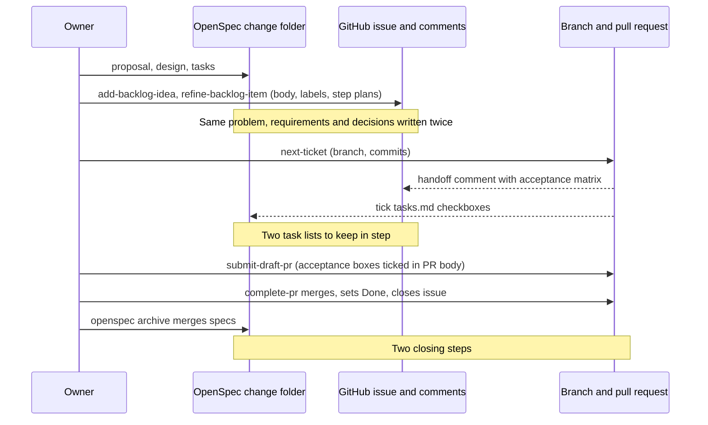

# Evaluation: does OpenSpec fit cardcleaner's GitHub project workflow?

## 0. Decision rule (written before the map)

Copied from design decision D4 (`design.md` lines 39-43) and fixed here before any map row is filled in:

- **Adopt as a supplement** only when OpenSpec fills a gap, and every overlap and conflict can be switched off
  without patching either system.
- **Adopt with adjustments** when the gap is real but some conflicts need a written rule (for example, who updates
  `openspec/specs/` after a merge). The report lists each adjustment.
- **Otherwise, do not adopt.**

Classification rule for each map row (design D3, `design.md` lines 32-36): *overlap* means both systems hold the
same content in different places; *conflict* means both would write or move the same record, or a rule of one
system forbids what the other does; *gap* means only one system holds that content.

## 1. How OpenSpec works

Installed CLI: `openspec --version` prints `1.8.0` (npm global `@fission-ai/openspec`, run on 2026-11-19).

### 1.1 What it creates and where it keeps state

| State | Where | Evidence |
|---|---|---|
| Project root and config | `openspec/config.yaml`: `schema: spec-driven`, every other key commented out (no `context`, `rules` or `operations`) | Read of the file; `openspec list --json` reports `"root": {"path": "C:\\Development\\Projects\\cardcleaner", "source": "nearest"}` |
| Change folder | `openspec/changes/<name>/` with `proposal.md`, `design.md`, `specs/**/*.md`, `tasks.md` and `.openspec.yaml` | `openspec status --change <name> --json`: `artifactPaths` lists `proposal.md`, `specs/**/*.md`, `design.md`, `tasks.md`, and `changeRoot` is `openspec\changes\evaluate-proposal-system-fit-with-git-project-workflow` |
| Change metadata | `.openspec.yaml` in the change folder; here `schema: spec-driven`, `created: 2026-11-19`, `skip_specs: true` | Read of the file |
| `skip_specs` flag | Marks a change with no spec delta; the `specs` artifact then counts as done | `openspec status --json` shows the `specs` artifact as `"status": "skipped"`; `openspec instructions specs --json` returns `"skipped": true` and the warning "This change declares skip_specs: true in .openspec.yaml ... so this artifact is skipped." |
| `retire_capabilities` flag | Lets archive delete a main spec when REMOVED entries take its last requirement | Not shown by `--help`, `status` or `instructions`. Shown by the CLI source: `dist/core/change-metadata/schema.js` lines 35-41 (schema field with comment) and `dist/core/archive.js` line 1106 (`readRetireCapabilitiesMarker` read before any spec is touched) |
| Archive | `openspec/changes/archive/<date>-<name>/` | `openspec archive --help`: "Archive a completed change and update main specs"; `dist/core/archive.js` lines 1098-1101 build the dated folder name, line 1112 creates `archiveDir` |
| Living specs | `openspec/specs/<capability>/spec.md`, written only by archive merging a change's deltas | `openspec archive --help` (`--skip-specs` "Skip spec update operations"); `openspec list --specs` prints `No specs found.` here |

The only file outside `openspec/changes/` is `openspec/config.yaml`; `openspec init --tools none` installed no
AI-tool files (design.md line 5, confirmed: the folder holds only `config.yaml`, `changes/`, `changes/archive/` and
`specs/`). The whole `openspec/` folder is untracked by git (`git status` at session start: `?? openspec/`).

### 1.2 What it expects to own

| It owns | How the CLI shows it | Driven by the proposal app stage by stage? |
|---|---|---|
| **The plan**: problem, scope, design decisions | `openspec instructions apply --change <name> --json` lists `proposal.md`, `design.md` and `tasks.md` under `contextFiles`, the files the apply stage must read first | Yes: the proposal stage writes `proposal.md`, `design.md`, specs and `tasks.md`. The stage instructions this run received from the proposal app (2026-11-19) forbid rewriting them during apply; this is the one claim in the report backed by those instructions rather than by a file, command or commit |
| **The task checkboxes** | `openspec status --json` has `"applyRequires": ["tasks"]`; `instructions apply` computes `progress` (`total`, `complete`, `remaining`) from the `- [ ]` / `- [x]` lines of `tasks.md`; `dist/core/archive.js` lines 1063-1087 count incomplete tasks and block archive (`archive_tasks_incomplete`) unless `--yes` | Yes: the apply stage ticks them, one per finished task |
| **The change status** | `openspec status --json`: per-artifact `status` (`done`, `skipped`), `isPlanningComplete`, `isComplete`; `openspec list --json`: `completedTasks`, `totalTasks`, `status: "in-progress"`. All of it is derived from the files, not stored | Read by each stage; nothing writes a status record |
| **The living spec** | `openspec archive` merges deltas into `openspec/specs/` and moves the change folder | Yes, but as its own stage: the same stage instructions say "Archiving is triggered separately by the user" and forbid `openspec archive` during apply. The shipped workflow templates keep apply and archive as separate files (`dist/core/templates/workflows/apply-change.js`, `archive-change.js`) |

OpenSpec has no link to GitHub issues, Projects or pull requests. A search of `dist/` for GitHub issue or Project
handling finds only `core/init.js` (opt-in GitHub Copilot cloud-agent files) and `commands/feedback.js`.
It has no priority or effort field: the four artifacts in `openspec status --json` are `proposal`, `specs`,
`design` and `tasks`, and `.openspec.yaml`'s schema (`schema.js`) has no such key.

## 2. How the GitHub flow works

cardcleaner's `CLAUDE.md` lines 731-738 ("Canonical dod-guard Workflow") name five skills: `/add-backlog-idea`,
`/refine-backlog-item`, `/next-ticket`, `/submit-draft-pr` and `/complete-pr`. Their rules live in the dod-guard
plugin.

### 2.1 Installed plugin against source repository (design D2)

| Copy | Identity | Evidence |
|---|---|---|
| Installed | dod-guard `5.13.4`, git commit `e209ce19d0a8e5fa46a60ab95f103e9041bbc4dc` (2026-11-04, merge of PR #1125), installed 2026-09-23, last updated 2026-11-04 | `~/.claude/plugins/installed_plugins.json` lines 223-230 |
| Source HEAD | `28f4569467592c1a5a115484163f325bacbeaba8` (2026-11-12, "test(review-pr): move the pending CLI test helpers to a support file (#1179)"); `plugin.json` still says `5.13.4` | `git log -1` in `~/mcp-servers/dod-guard`; `plugins/dod-guard/.claude-plugin/plugin.json` line 3 |

Both copies carry the version string `5.13.4`, so they are told apart by commit. `git log e209ce19..HEAD` counts
291 commits between them.

**The installed copy is incomplete.** `~/.claude/plugins/cache/dod-guard/dod-guard/5.13.4/` holds 93 files. Its
`skills/` folder has only `add-backlog-idea`, `blind-rewrite`, `clean-house` and `codex-advisor`, and it has no
`standards/` folder, while `git ls-tree e209ce19 plugins/dod-guard/skills/` lists 23 skill folders, including
`refine-backlog-item`, `next-ticket`, `submit-draft-pr` and `complete-pr`. The skill list of this session shows the
same: of the five workflow skills only `dod-guard:add-backlog-idea` is offered. So design.md line 6 ("The copy that
sessions run is under `~/.claude/plugins/`") holds for one of the five skills only. This report therefore reads the
workflow rules at the installed commit through git (`git show e209ce19:<path>`) and cites them as `e209ce19:<path>`.
This evaluation does not repair the cache: it changes no plugin file.

**Workflow rules that differ between `e209ce19` and HEAD** (from `git diff e209ce19 HEAD` of the five `SKILL.md`
files and `standards/project-workflow.md`). None moves a record out of GitHub or into the repository:

- `add-backlog-idea`: one batched question round when a user is present (HEAD `SKILL.md` line 76), a duplicate
  title check before creating, and Status set to `Backlog` only when the item has none.
- `refine-backlog-item`: a repository gate preflight, at most 5 slices per structured parent (HEAD line 67),
  `File:` and `Proxy check:` lines and an optional `Tier: standard` line in each step plan, and a signature dry run
  with the quality scanner before a plan is posted.
- `project-workflow.md`: requirement ids (`R-1`) that each acceptance checkbox must cite, and
  `refinement --plans --root` proxy checks.
- `next-ticket`: Resume (HEAD line 61) and Adopt (HEAD line 71) paths for existing branches, and a branch check
  before every commit.
- **One ownership move:** at `e209ce19`, `next-ticket` adds the `## Preflight checkpoint` once the PR exists
  (`e209ce19:plugins/dod-guard/skills/next-ticket/SKILL.md` line 92). At HEAD it writes none (HEAD line 135) and
  `submit-draft-pr` writes it (HEAD `standards/project-workflow.md` line 117). The record stays in the same issue
  comment.
- `submit-draft-pr`: an Update mode for a moved head (HEAD line 78).
- `complete-pr`: refuses to run outside a checkout, and its closure `apply` sets `Done` as a backstop when a merged
  issue's own completion record verifies.

The "Never create a tracked planning file" rule is at line 20 at `e209ce19` and line 21 at HEAD, same wording.
`standards/project-workflow.md` lines 12-24 are the same at both commits (the diff starts at line 89).

### 2.2 What each skill writes, and where

All citations are `e209ce19:plugins/dod-guard/skills/<skill>/SKILL.md`.

| Skill | Writes | Where | Lines |
|---|---|---|---|
| `add-backlog-idea` | A new issue with `## Idea`, `## Context`, optional `## Open questions`; adds it to the Project and sets Status `Backlog`. No labels, criteria, notes or subtasks | GitHub issue body; Project Status | 18-27, 66-78 |
| `refine-backlog-item` | `## Outcome`, `## Scope`, `## Implementation notes` (triage, research, the seven structured records), `## Acceptance criteria`, `## Verification`; one priority and one effort label; linked sub-issues for independent slices; one `## Step plan: <task-id>` comment per task; moves Status to `Todo` | Issue body, labels, sub-issues, issue comments, Project Status | 20-21, 42-56, 66-71, 89-95, 99-104 |
| `next-ticket` | Branch `codex/<issue>-<slug>` pushed to `origin`; assignee; Status `In Progress`; commits; one `## Implementation handoff` comment holding the `## Acceptance matrix` (and, at this commit, the `## Preflight checkpoint`) | Git branch; issue assignee; Project Status; issue comment | 20, 48-55, 92, 100 |
| `submit-draft-pr` | One draft PR whose body has the change summary, the acceptance checklist checked where evidence exists, `Closes #<issue>` and a `## Convergence` block linking the handoff; leaves Status `In Progress` | Pull request body | 50, 61-76 |
| `complete-pr` | Guarded merge; remote branch deletion; children and parent set to `Done`; one `## Completion evidence` comment per closing issue; closes replaced issues | Pull request, branch, Project Status, issue comments | 3, 77, 100-124 |

The `## Completion evidence` record is defined in `e209ce19:plugins/dod-guard/standards/project-workflow.md`
lines 224-227. `submit-draft-pr` line 50 also says "Never create a local ledger", and `next-ticket` line 100 says
the matrix is "the durable acceptance record ... so never copy it to a local ledger or second issue".

### 2.3 Source-of-truth rules

`plugins/dod-guard/standards/project-workflow.md` lines 12-24 (same text at `e209ce19` and HEAD):

> Both paths use the repository's linked GitHub Project, issue, branch, commits,
> and pull request as the source of truth.
>
> ## Principles and source of truth
>
> - Existing repository instructions in `AGENTS.md` and `CLAUDE.md` are the
>   project-principles source. Preserve both when both exist and follow the
>   repository's existing import convention. Do not add a second constitution.
> - The GitHub issue holds the outcome, requirements, decisions, plan, tasks,
>   acceptance criteria, and verification. Project Status records lifecycle.
>   Branch history and the pull request hold implementation and review evidence.
> - OpenSpec material is historical reference only. It is not an active runtime,
>   dependency, or source of truth.

`e209ce19:plugins/dod-guard/skills/next-ticket/SKILL.md` line 20 (line 21 at HEAD):

> - Never create a tracked planning file; keep temporary notes outside the repo or remove them before commit.

### 2.4 Spot check against real issues (read only)

- **Issue 419** ("Friction log 2026-11-02", closed `COMPLETED`, `gh issue view 419`): body headings `## Outcome`,
  `## Scope`, `## Implementation notes` with `### requirements`, `### clarifications`, `### implementation-plan`,
  `### task-list`, `### lens-ownership`, `### acceptance-evidence`, `### planned-acceptance-matrix`, then
  `## Acceptance criteria` and `## Verification`; labels `bug`, `Prio 4 - Non-Urgent`, `Effort 2 - Easy`; Project
  `CardCleaner` Status `Done`; closed by PR 450. Its comments (`gh api .../issues/419/comments`) are, in order,
  `## Step plan: T1` (2026-11-11 09:29), `## Implementation handoff` (10:40) and `## Completion evidence` (12:54).
  This is the full chain, every record where the skills say.
- **Issue 448** (closed `COMPLETED`): headings `## Idea`, `## Context`, `## Outcome`, `## Scope`,
  `## Implementation notes`, `## Acceptance criteria`, `## Verification`; labels `bug`, `Prio 3 - Standard`,
  `Effort 3 - Medium`; Status `Done`; closed by PR 449 from branch `codex/448-recover-lost-suite-start`. Its only
  comment is `## Completion evidence`: no step plan and no handoff, and PR 449's body has no `## Convergence`
  section. This is the ordinary path for a small fix (`project-workflow.md` lines 9-11), so it confirms the issue,
  labels, branch and Status, but not the structured records.
- **Recent work runs outside the flow.** `gh pr list --state merged --limit 30` shows the last issue-linked PR is
  451 (merged 2026-11-12, `codex/445-...`). The eleven PRs merged since, 453 to 463 (2026-11-15 to 2026-11-18), come
  from `feature/*`, `fix/*` and `perf/*` branches and close no issue; their bodies reference no issue number except
  PR 455, whose body line 28 points to `TychoHenzen/Asset-Manager#2`, an issue in another repository. The open PR 466 (`feature/item-handling`) also closes none. No issue was
  created after 452 (2026-11-12). PR 461's body has only `## Summary` and `## Tests`; PR 466's has
  `## What changed for the player`, `## Other changes`, `## Verification`, `## For the reviewer`. For this work no
  plan record exists before the PR, in GitHub or in the repository:
  `git log --no-merges --since=2026-11-14 --name-only --format= -- '*.md'` lists only `CLAUDE.md` (in 35 of the 99
  non-merge commits since that date) and `tools/e2e/README.md` (once). This contradicts proposal.md line 3
  ("The repository already plans and tracks all work through the dod-guard issue flow"). This report does not say
  why; the incomplete plugin cache above is one possible factor, but nothing here dates when the cache lost its
  files, so no causal link is claimed.

## 3. Side-by-side map

Abbreviations: `PW` is `plugins/dod-guard/standards/project-workflow.md` (lines 12-24 are the same at `e209ce19` and
HEAD); `<skill> L<n>` is `e209ce19:plugins/dod-guard/skills/<skill>/SKILL.md` line n.

### 3.1 The map

| # | Stage | OpenSpec: record and writer | GitHub flow: record and writer | Class | Why (rule D3) |
|---|---|---|---|---|---|
| 1 | Problem | `proposal.md` `## Why`, written at the proposal stage; read by apply as a required context file (`instructions apply` `contextFiles`) | Issue `## Idea` and `## Context` (`add-backlog-idea` L66-70), later `## Outcome` (`refine-backlog-item` L48) | Conflict | Same content in two places, and PW lines 20 and 23-24 make the issue the holder of the outcome and forbid OpenSpec as a source of truth, which is what apply makes of `proposal.md` |
| 2 | Requirements | `specs/<capability>/spec.md` deltas (`### Requirement`, `#### Scenario`), per `instructions specs` | Issue `## Scope`, `## Acceptance criteria`, `requirements` record (`refine-backlog-item` L48, L66); at HEAD each criterion cites requirement ids `R-n` | Conflict (switchable) | PW line 20 names requirements and acceptance criteria as issue content. This is the one OpenSpec row that configuration switches off: `skip_specs: true` in `.openspec.yaml` (`schema.js` line 34) |
| 3 | Design choices | `design.md` `## Decisions` | `## Implementation notes`: `clarifications`, `accepted-option`, `rejected-option`, `implementation-plan` (`refine-backlog-item` L32-40, L66) | Conflict | PW line 20 names decisions as issue content; OpenSpec apply reads `design.md` as a context file |
| 4 | Tasks | `tasks.md` checkboxes; `applyRequires: ["tasks"]`; apply ticks them; archive blocks on unticked ones (`archive.js` L1063-1087) | `task-list` record, sub-issues and one `## Step plan` comment per task (`refine-backlog-item` L54-56, L89-95); acceptance boxes ticked in the PR body (`submit-draft-pr` L63) | Conflict | PW line 20 names tasks as issue content; both systems' implementation stage ticks its own list. The `spec-driven` schema makes apply depend on `tasks.md` (`schemas/spec-driven/schema.yaml` lines 205-207), and no `.openspec.yaml` flag skips it |
| 5 | Status | Derived on every call from the files: `openspec status --json` (`isComplete`, artifact `status`), `openspec list --json` (`completedTasks`) | Project Status column, moved `Backlog` to `Todo` to `In Progress` to `Done` by four skills (`add-backlog-idea` L78, `refine-backlog-item` L104, `next-ticket` L55, `complete-pr` L113) | Overlap | Both describe lifecycle, but OpenSpec writes no status record, so nothing is written twice. Its status follows from the tasks list, whose conflict is row 4 |
| 6 | Where the plan lives | `openspec/changes/<name>/` in the repository (here `planningHome.kind: "repo"` in `openspec status --json`), or in a separate store repository registered with `openspec store setup` / `register` ("standalone OpenSpec repos you register on this machine", `openspec store --help`) | Issue body and issue comments; "Never create a tracked planning file" (`next-ticket` L20); "Never create a local ledger" (`submit-draft-pr` L50) | Conflict | In the repository, a committed change folder is the tracked planning file that `next-ticket` L20 forbids, and an untracked one is lost with the working tree. A store keeps the folder out of cardcleaner and meets the letter of L20, but the plan is then still a second home beside the issue (PW lines 20, 23-24) |
| 7 | Closing | `openspec archive` moves the folder to `changes/archive/<date>-<name>/` and merges deltas into `openspec/specs/` (`archive --help`; `archive.js` L1098-1112) | `complete-pr`: guarded merge, branch deletion, `Done`, `## Completion evidence` comment (`complete-pr` L3, L100-124) | Overlap | Two closing steps for one piece of work, but they write different records: no record is written by both |
| 8 | Priority and effort | None: the artifacts are `proposal`, `specs`, `design`, `tasks` (`openspec status --json`) and `.openspec.yaml` has no such key (`schema.js` L18-41) | One `Prio n` and one `Effort n` label, with rationale in Implementation notes; `Effort 13` blocks `Todo` (`refine-backlog-item` L20-21, L42-44, L75-77) | Gap (GitHub only) | Only the GitHub flow holds it |
| 9 | Step plans for a cheap implementer | None | One `## Step plan: <task-id>` comment per task, every design decision settled (`refine-backlog-item` L89-95; PW line 42) | Gap (GitHub only) | Only the GitHub flow holds it |
| 10 | Implementation evidence | None beyond ticked boxes in `tasks.md` | Branch `codex/<n>-<slug>`, commits, one `## Implementation handoff` comment with the `## Acceptance matrix` bound to the pushed head (`next-ticket` L48-55, L88-100) | Gap (GitHub only) | Only the GitHub flow holds it |
| 11 | Review and convergence | None | Draft PR with `## Convergence`, `Closes #<n>` (`submit-draft-pr` L61-76); `dod-guard:review-pr` as "the one independent review" (`next-ticket` L108) | Gap (GitHub only) | Only the GitHub flow holds it |
| 12 | Lasting record of behavior | `openspec/specs/<capability>/spec.md`, merged by archive, validated by `openspec validate --strict` | No skill writes one. PW lines 17-19 make `CLAUDE.md` / `AGENTS.md` the principles source, and cardcleaner's `CLAUDE.md` is updated in the same PRs as the code (see 3.2) | Gap (OpenSpec only), covered in practice | No dod-guard skill holds it; section 3.2 judges whether `CLAUDE.md` already does |

**Result of the classification.** Five conflicts (rows 1, 2, 3, 4, 6), two overlaps (5, 7), four gaps on the GitHub
side (8 to 11) and one gap on the OpenSpec side (12).

This differs from design D4, which expected four conflicts named "tasks, status, where the plan lives, closing".
Applying D3 literally moves **status** and **closing** to overlaps (neither writes a record the other writes, and no
rule of one forbids the other's act), and adds **problem**, **requirements** and **design choices** as conflicts,
because PW line 20 names the outcome, requirements and decisions as issue content and lines 23-24 forbid OpenSpec as
a source of truth. The verdict does not depend on this difference: row 4 alone cannot be switched off by any
`.openspec.yaml` flag.

**Can the conflicts be switched off without patching?**

- Row 2: yes, `skip_specs: true`.
- Rows 1, 3, 4: not with the shipped `spec-driven` schema (`openspec schemas` lists only that one; its artifacts are
  `proposal`, `specs`, `design`, `tasks`, and apply requires and tracks `tasks.md`, `schema.yaml` lines 205-207).
  `openspec schema fork` and `openspec schema init` (marked experimental in `openspec schema --help`) can create a
  project-local schema, which is configuration, not a patch. This evaluation did not test whether a schema without a
  `tasks` artifact validates and archives, because creating one writes outside this change folder. A schema with
  only a specs artifact is the one configuration that could avoid rows 1, 3 and 4.
- Row 6: only partly. Inside cardcleaner, any lasting change folder must be committed, and that is the file
  `next-ticket` L20 forbids. An OpenSpec store moves the folders and specs into a separate repository, which meets
  the letter of L20 (configuration, not a patch), but rows 1, 3 and 4 still conflict with PW lines 20 and 23-24
  wherever the folder lives. A store also moves the spec record out of the pull requests that review the code, which
  removes the one advantage it would have over `CLAUDE.md` (reviewed with the code, 3.2). `openspec/specs/` alone is
  not a planning file, so a specs-only use would avoid L20, but it would be a second record of behavior beside
  `CLAUDE.md` (3.2).

### 3.2 The living spec record against `CLAUDE.md`

What OpenSpec's `openspec/specs/` would add is a per-capability, requirement-and-scenario record of current behavior,
merged at each archive and checked by `openspec validate --strict`.

cardcleaner's `CLAUDE.md` (857 lines) already records current behavior, in prose, often with the test that pins it:

- "Cards rest on top of the floor" (line 124), naming `CardFloorRestTest` and `ACardJoltPutsToSleepIsFrozen`.
- The XP rule `max(1, paid / 10)` and the level thresholds (line 824).
- The day close order (line 833).
- 22 lines contain "fails when", "fails if", "fails on", "pins it", "pinned by" or "enforces" (`grep -c -E` over the
  file), each tying a stated behavior to a check.

It is tracked and reviewed in the same pull request as the code. Since 2026-11-14 it
changed in 35 of the 99 non-merge commits (`git log --no-merges --since=2026-11-14 -- CLAUDE.md`), including on the
off-flow branches of section 2.4. No other Markdown file records behavior: the same log touches only
`tools/e2e/README.md` besides it.

**Judgement: the gap is covered, not real, for this repository.** `CLAUDE.md` plus the tests it names hold the
lasting record of behavior. What OpenSpec would add is structure (one file per capability, WHEN/THEN scenarios, a
validator), not a record that is missing. Adding `openspec/specs/` would put the same statements in a second place.
dod-guard's own August 2026 plan named that risk when it chose OpenSpec over a separate decisions file: "A second
file would only drift from it" (`git show 51037e82~1:docs/plans/2026-08-11-openspec-migration.md` line 21). PW
line 19 ("Do not add a second constitution") is a near analogy only: it is about the principles source, while
`openspec/specs/` would hold behavior. One honest limit: whether the owner
wants that structure is a preference this report cannot read from the repository. Section 5 asks it.

### 3.3 Diagrams

Architecture, adjusted from `design.md` lines 50-75: the acceptance matrix sits in the handoff comment, the
acceptance boxes are ticked in the PR body, and recent work also reaches the code through PRs with no issue
(section 2.4).

*Caption: the dod-guard skills write every planning record to GitHub, while OpenSpec's two folders would hold copies
of the issue and of CLAUDE.md in the repository; feature PRs without an issue change code and CLAUDE.md with no
planning record at all. Supports 3.1 and 3.2.*

Sequence, adjusted from `design.md` lines 81-97: the GitHub side ticks acceptance boxes in the PR body and keeps the
matrix in the handoff comment, not in the issue body.

*Caption: running both systems on one piece of work writes the plan twice, ticks two task lists and needs two
closing steps. Supports rows 1 to 7 of 3.1.*

## 4. Why dod-guard dropped OpenSpec

### 4.1 What was written down

- Commit `51037e82` (2026-09-03 16:38, "feat(workflow): replace OpenSpec with GitHub issues") has no body: its
  message is the subject line only (`git show -s --format=%B 51037e82`). It changed 662 files, 6149 insertions and
  49559 deletions.
- It was merged as PR #11 (merge `99f16c12`, branch `codex/1-replace-openspec`). The PR body
  (`gh pr view 11` in dod-guard) lists what changed (GitHub issues, read-only PR CI, removing micro-mutations,
  retiring the OpenSpec runtime, archiving its history, a quality-report dashboard) and what was verified. It states
  no reason.
- Issue #1 ("Replace OpenSpec", opened 2026-09-03 13:38, closed 18:00, `gh issue view 1`) says only "Replace
  per-task OpenSpec files with GitHub Issues, linked Projects, feature branches, and draft pull requests." Its
  implementation notes add "Keep durable architecture guidance in the repository. Preserve old OpenSpec material as
  a clearly historical archive." Sub-issues #2 to #10 are the work items (resolve the Project, branch, draft PR,
  read-only CI, disable micro-mutations, protect `master`, remove OpenSpec, archive it, document the workflow). None
  states a reason.
- `AGENTS.md` in that commit: the removed text described the split "OpenSpec owns a change's artifacts and the
  rules for authoring them, dod-guard owns proof, and a skill owns choreography", a hygiene check that failed "a
  skill that names a second home for the plan", the OpenSpec spec layout, and an `openspec validate --all --strict`
  CI gate. The added text is a `## GitHub delivery` section: "Per-task requirements live in GitHub Issues", one
  parent issue to one `codex/<issue>-<slug>` branch and one draft pull request. No sentence says why.
- `docs/archive/openspec-history/README.md` (added in that commit, 8 lines) says the records are kept "for
  history", that nothing there is active, and that "Current work is tracked through GitHub Issues, sub-issues,
  feature branches, draft pull requests, and the linked GitHub Project." No reason.
- The commits just before it (`git log -15 51037e82~1`, all on 2026-09-03) are OpenSpec dashboard and code-explorer
  work and an OpenSpec archive commit (`2957520e`); none mentions leaving OpenSpec. A search of dod-guard's history
  for "replace/drop/remove OpenSpec" finds only `51037e82` and its merge.
- `git grep -n -i openspec HEAD -- '*.md' ':!docs/archive'` in dod-guard finds only a stale micro-mutation report
  (`.data/micro-mutations/REPORT.md`), the dashboard row in `AGENTS.md` line 15 and an August handoff note
  (`docs/handoffs/2026-08-30-serena-code-explorer.md` line 12). None gives a reason.
- The memory folders of past sessions hold no note on why. A grep for `openspec` over
  `~/.claude/projects/*/memory/*.md` finds path and tooling notes, plus one note
  (`cloud-sessions-unusable-run-local.md` line 15) that only says a session named "Replace OpenSpec" was archived.
  No top-level dod-guard session transcript in `~/.claude/projects/C--Users-siriu-mcp-servers-dod-guard/` has a user
  message mentioning OpenSpec between 2026-08-30 and 2026-09-05 (node scan of the `.jsonl` files by timestamp).

**Reason: none was written down.** Two pieces of context come close, and they are context, not a stated reason:
the old rule that a skill must not name "a second home for the plan" (the one-home principle survived the switch,
with the home moved from OpenSpec to the issue), and issue #1's "Keep durable architecture guidance in the
repository", which puts the lasting record in `AGENTS.md` / `CLAUDE.md` rather than in `openspec/specs/`.

### 4.2 Has anything changed since 2026-09-03?

- **OpenSpec itself: no version change.** dod-guard's CI installed `@fission-ai/openspec@1.8.0` just before the
  switch (`git grep` at `51037e82~1`: `.github/workflows/ci.yml` lines 50, 90 and 119). The CLI installed here is
  also `1.8.0`. Whatever the reason was, it was not fixed by a newer OpenSpec.
- **The way OpenSpec is driven is new.** proposal.md line 3 describes OpenSpec as "driven stage by stage by the
  proposal app". That lowers the effort of running the stages. This report cannot date when the app appeared, and it
  does not touch the one-home rule: the app still writes the same change folder.
- **The dod-guard flow grew, but its homes did not move.** The rules now carry handoff proofs, acceptance matrices
  and step plans (section 2.1), and every one lives in an issue, a comment or the PR. PW lines 12-24 are unchanged
  between `e209ce19` and HEAD.
- **cardcleaner's practice changed.** Since 2026-11-15 the merged work runs outside the issue flow (section 2.4), and
  four of the five flow skills are missing from the installed plugin cache (section 2.1). For that work there is no
  plan record at all, so the one-home rule has no home to protect there. This is the only change found that weakens
  the case for staying with GitHub alone, and it is about the off-flow work, not about OpenSpec as a supplement to
  the flow.

## 5. Recommendation

### 5.1 Applying the decision rule

1. *Does OpenSpec fill a gap?* Its only gap-filling row is row 12, the lasting record of behavior. Section 3.2
   finds that gap covered by `CLAUDE.md` and the tests it names. So the precondition of both adopt options fails.
2. *Could every overlap and conflict be switched off without patching?* Only row 2 by a shipped flag. Rows 1, 3 and
   4 would need an untested experimental project-local schema, and row 6 is avoided only by moving the folders into
   a separate store, where rows 1, 3 and 4 still conflict with PW lines 20 and 23-24. So "adopt as a supplement"
   fails on this test too.
3. *Adopt with adjustments* needs a real gap. It would apply only if the owner wants the structured spec record
   that `CLAUDE.md` does not give (5.3).

**Recommendation: do not adopt OpenSpec for cardcleaner.** Keep the GitHub issue flow as the one home for planned
work and `CLAUDE.md` as the record of behavior.

### 5.2 Evidence that points against this recommendation

- **Off-flow work has no plan record at all.** PRs 453 to 463 and the open PR 466 link no issue (section 2.4). For
  that work the GitHub flow is not the source of truth, so the conflicts in 3.1 would not bite. An OpenSpec change
  folder could hold a plan where today none exists. That would replace the flow for that work, not supplement it,
  and it would still meet `next-ticket` L20 if the work later returned to the flow. The better first question is
  whether the off-flow work is intended (5.3, question 2).
- **The flow is not fully runnable here today.** Four of the five workflow skills are missing from the installed
  plugin cache (section 2.1), so a session in this repository cannot invoke them. That weakens the claim that the
  flow "owns" planning in practice, but it is a broken install, not a design gap that OpenSpec fills.
- **Small fixes skip the structured records.** Issue 448 carried no step plan or handoff (section 2.4). That is the
  documented ordinary path (PW lines 9-11), not a missing record.
- **A spec-only OpenSpec setup might be configurable.** `openspec schema init` / `fork` (experimental) could define
  a schema with only a specs artifact, which would avoid rows 1, 3, 4 and 6, and an OpenSpec store could keep every
  change folder out of cardcleaner. Neither was tested (section 3.1), and even if both work they would only add
  structure to a record `CLAUDE.md` already keeps; a store would also take that record out of the code's reviews.
- **This classification found five conflicts, not the four design D4 expected**, and moved status and closing to
  overlaps (section 3.1). The difference does not change the verdict.

### 5.3 Open questions for the owner

1. **Did you miss OpenSpec's living spec record after September, or does `CLAUDE.md` cover it well enough?**
   (From `design.md` lines 151-153.) If you miss it, the verdict becomes "adopt with adjustments" for the spec record
   alone, with these adjustments: a spec-only project-local schema (to be tested first), a written rule for who
   updates `openspec/specs/` after each merge, and a rule for which statements leave `CLAUDE.md` so behavior is not
   recorded twice. **While this question is unanswered, the recommendation stays "do not adopt".**
2. **Is the work since 2026-11-15 on `feature/*` branches without issues meant to bypass the issue flow?** If yes,
   the useful decision is what planning record that work should have, which is a separate question from this one.
   If no, repairing the plugin install (section 2.1) comes before any new planning system.

## 6. Follow-up the verdict implies

Nothing below is done by this change.

- **Keep the report.** Copy `evaluation.md` to `C:\Development\Projects\dependency-map2\` (where analysis output for
  this repository goes) before the `openspec/` folder is removed, because the folder is untracked and the report
  lives only there.
- **Decide on the untracked `openspec/` folder.** Either remove it once the report is copied (no other content
  depends on it: no specs, one change), or, if OpenSpec stays installed for the proposal app, add a `.gitignore`
  entry for `openspec/` with a comment naming the proposal app as its writer, so it never lands in a commit.
- **Not part of this verdict, but found here:** the installed dod-guard cache is missing 19 of the 23 skill folders its commit holds, and its
  `standards/` folder. The fix belongs in the plugin tooling (`/plugin update` or a reinstall), never in
  `~/.claude/plugins/` by hand.
- **If question 1 is answered "yes"**, a later change would edit: a new project-local schema under
  `openspec/schemas/`, a `.gitignore` entry for `openspec/changes/` (so change folders stay untracked), cardcleaner's
  `CLAUDE.md` section "Canonical dod-guard Workflow" (who updates `openspec/specs/` after a merge), and the sections
  of `CLAUDE.md` whose statements move into specs.
