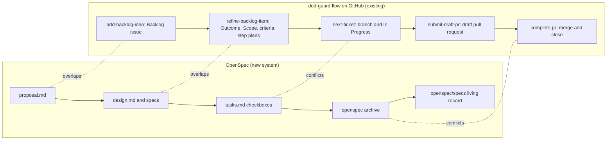

## Why

A new system for creating and managing proposals (OpenSpec, driven stage by stage by the proposal app) is being considered for cardcleaner. The repository already plans and tracks all work through the dod-guard issue flow on GitHub. Nobody has yet written down whether the two systems would fight over the same work or whether OpenSpec would add a step the GitHub flow lacks. Adopting it without that answer risks two competing sources of truth for planned work.

The question is urgent for one more reason. dod-guard, the plugin that defines the GitHub flow, used OpenSpec from August 2026 and replaced it with GitHub issues on 2026-09-03 (commit `51037e82` in `~/mcp-servers/dod-guard`). Its workflow standard now calls OpenSpec "historical reference only". Adopting OpenSpec again would reverse that decision, so the evaluation has to say whether anything has changed since then.

## What Changes

- Write one evaluation report, `evaluation.md`, inside this change's own folder. It is the only output of the change.
- The report describes how OpenSpec works end to end: what it creates, where it stores state, and what it expects to own.
- The report describes the current GitHub flow: where issues, branches, pull requests and their status live, and which skill owns each step.
- The report maps the two side by side. It lists every overlap (both own the same thing), every gap (only one side has it) and every conflict (both want control of the same file or step), each with the file and line that proves it.
- The report ends with one recommendation: adopt as a supplement and say where it plugs in, adopt with adjustments and list them, or do not adopt.
- No game code, test, configuration, CI file, workflow skill or GitHub issue changes. The investigation reads only.

## Capabilities

### New Capabilities

None. The change produces a decision record and changes no behavior of the game or of the workflow, so `.openspec.yaml` sets `skip_specs: true`.

### Modified Capabilities

None. The repository has no `openspec/specs/` capabilities.

## Involved Repositories

No confirmed repository scope is specified for this change. The user has not specified any repositories, project references, or vaults.

## Code Change Table

| File Path | Change Type | Change Reason | Impact Scope |
|-----------|-------------|---------------|--------------|
| `openspec/changes/evaluate-proposal-system-fit-with-git-project-workflow/evaluation.md` | Added | Holds the description of both systems, the side-by-side map and the recommendation | This change folder only; untracked by git |
| `Scripts/`, `Tests/`, `UnitTests/`, `Scenes/`, `.github/`, `CLAUDE.md` | Unchanged | The investigation must change nothing it evaluates | None |
| `~/mcp-servers/dod-guard` (skills, standards, OpenSpec archive) | Read only | Source of the GitHub flow's rules and of the earlier OpenSpec decision | None |

## Interaction Flow

*Caption: each OpenSpec stage lines up with a dod-guard stage that already owns the same content, and only the living spec record has no counterpart. Supports the What Changes section.*

## Impact

- Gives a go or no-go decision on adopting OpenSpec before any workflow file changes.
- Keeps one source of truth for planned work while the decision is open: nothing is moved out of GitHub issues.
- Affects no code, API, dependency or CI job. The only new file is the report inside this change folder.
- The `openspec/` folder created when this change was set up stays untracked. What happens to it depends on the recommendation and is decided after the report, not by this change.
